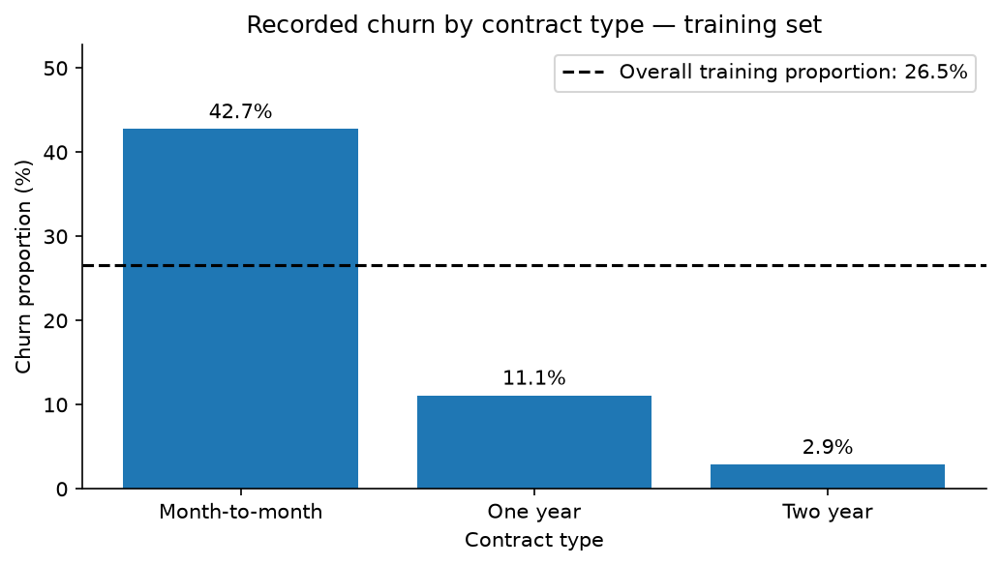

# Customer Churn Analysis

An exploratory and statistical analysis of IBM's fictional Telco Customer Churn sample, built with Python, pandas, Matplotlib, SciPy, and statsmodels.

**Status:** Current release completes data preparation, exploratory analysis, and selected statistical comparisons. Multivariable modeling and held-out predictive evaluation are planned extensions. No predictive model performance is claimed.

## Business question

Which customer characteristics, services, and account features are associated with recorded churn? The analysis identifies groups for further retention research rather than claiming that a specific intervention will prevent churn.

## Current findings

All figures below refer to the **5,634-customer training sample**, not the full dataset.

| Finding | Result |
|---|---|
| Recorded churn | 26.54% |
| Churn by contract | Month-to-month 42.75%; one year 11.08%; two year 2.87% |
| Month-to-month minus one year | 31.66 percentage points; 95% CI 29.08–34.08 |
| Month-to-month minus two year | 39.88 percentage points; 95% CI 37.86–41.79 |
| Mean tenure: churned minus non-churned | −19.23 months; 95% CI −20.47 to −17.99 |

Month-to-month churn remains highest within every displayed tenure band. Monthly-charge groups show a nonmonotonic pattern; service and billing differences remain unadjusted.



## Data and methods

The CSV has 7,043 records and 21 columns. IBM defines churn as leaving within the last month. See [data documentation](data/README.md) for the source and download instructions.

- Validate structure, IDs, missingness, types, ranges, and service consistency.
- Convert 11 blank `TotalCharges` entries to missing numerical values; retain all customers without assuming zero charges.
- Reserve a reproducible stratified 20% test sample (`random_state=42`). Use training data for exploration and current comparisons.
- Summarize subgroup counts, proportions, distributions, and contract–tenure overlap.
- Quantify selected comparisons using Wilson and Newcombe intervals, Pearson chi-square, Cramér's V, and Welch inference.

## Reproduce

Validated with **Python 3.12.8**. From the repository root, using PowerShell:

```powershell
python -m venv .venv
.\.venv\Scripts\python.exe -m pip install -r requirements.txt
```

Download the source CSV as described in `data/README.md`. Open `notebooks/customer_churn_analysis.ipynb` in PyCharm and select `.venv` as the interpreter/kernel. **Set the notebook working directory to the repository's `notebooks` folder.** The first cell uses `../data/telco_customer_churn.csv`. Restart the kernel and run all cells in order.

Executed outputs are saved for reading directly on GitHub. The notebook does not download data or require personal absolute paths.

## Repository structure

```text
README.md
requirements.txt
.gitignore
data/README.md
notebooks/customer_churn_analysis.ipynb
figures/                  # Selected notebook figures
```

The downloaded CSV is stored locally under `data/` and excluded from Git. Earlier working notebooks and the local Python environment are not part of this publication version.

## Limitations

The data are fictional and observational, with uncertain sampling and feature timing. Comparisons are exploratory and unadjusted. Conventional inferential intervals illustrate assumptions; they do not account for selection, multiplicity, or the stratified split design. Findings do not identify intervention effects or establish performance for future churn forecasting. Prior exploration also limits independence of the reserved test sample.

## Planned extensions

- Interpretable multivariable logistic regression, addressing structural service categories and nonlinearity.
- Training-only model development and a fixed held-out evaluation against a baseline.
- A concise report based on verified results.

The current release is reproducible independently of these extensions.
